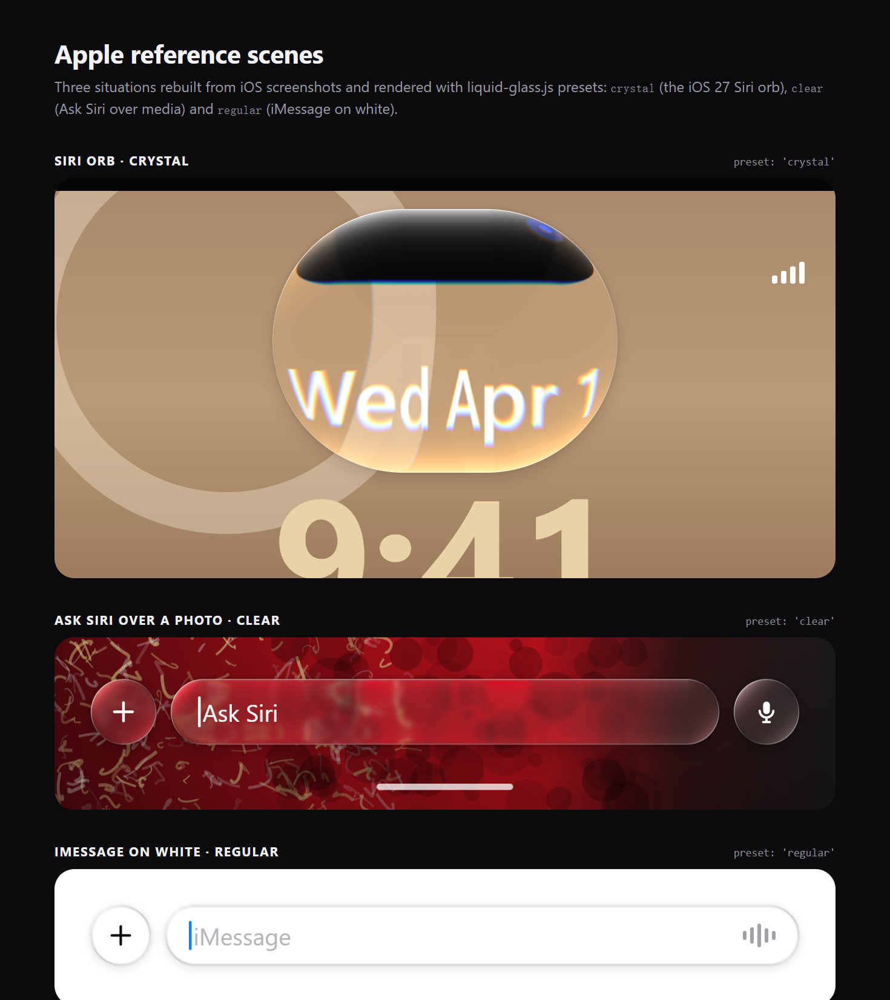
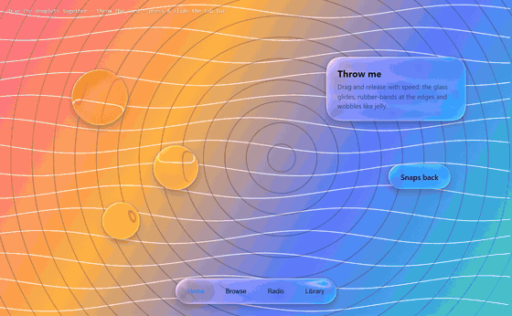

<div align="center">

# The Best Liquid Glass

[English](README.md) · [简体中文](README.zh-CN.md) · [繁體中文](README.zh-TW.md) · [日本語](README.ja.md) · [한국어](README.ko.md) · **Español**

Una recreación **física y en tiempo real** del **Liquid Glass** de Apple para la web:
refracción de Snell real sobre un bisel curvo, dispersión espectral, reflexión de Fresnel, brillo especular teñido por el contenido,
fusión líquida y adaptación claro/oscuro. WebGL2 puro, sin dependencias.

**[▶ Demo en vivo](https://the-best-liquid-glass.pages.dev)** · [Vídeo](docs/media/demo.mp4) · [Úsalo en tu web](#úsalo-en-tu-web) · [Skill para IA](#skill-para-ia)

[](docs/media/demo.mp4)

<sub>Haz clic en la imagen para ver el vídeo de 45 segundos (1080p).</sub>

</div>

---

## ¿Por qué otro liquid glass?

Casi todo el "liquid glass" de la web es un desenfoque, un borde blanco y quizá un desplazamiento RGB. Eso es glassmorphism, no vidrio.
El material de Apple es una **lente**: el centro plano queda nítido mientras el borde curvo dobla y concentra la luz, así que el contenido de detrás se estira y envuelve el contorno. Este proyecto resuelve esa óptica píxel a píxel.

| "Liquid glass de IA" típico | Este proyecto |
|---|---|
| `backdrop-filter: blur()` + borde | Refracción de Snell a través de un bisel con perfil squircle |
| Desplazamiento de canales RGB | 7–16 longitudes de onda refractadas por separado y recombinadas con una respuesta espectral |
| Capa de brillo blanco | Borde especular hacia la luz + reflexión interna en el lado opuesto, con el color del contenido (OKLab) |
| Aspecto fijo | Adaptación claro/oscuro, reflexión de Fresnel, sombra de contacto, fusión líquida, brillo al tocar, física de gelatina |

<p align="center"></p>

## Funciones

<table>
<tr>
<td width="50%"><br><b>Lente.</b> Centro nítido, borde que amplía. El texto se curva con el contorno.</td>
<td width="50%"><br><b>Dispersión espectral.</b> Arcoíris continuo en bordes de alto contraste.</td>
</tr>
<tr>
<td><br><b>Fusión líquida.</b> Campos de distancia con signo mezclados con un mínimo suave.</td>
<td><br><b>Gota en la barra de pestañas.</b> La selección se eleva como una lupa que refracta el vidrio de debajo.</td>
</tr>
<tr>
<td><br><b>Transformación.</b> Un botón fluye hasta convertirse en menú.</td>
<td><br><b>Controles de vidrio.</b> Los mandos del deslizador y del interruptor se vuelven lentes al arrastrarlos.</td>
</tr>
<tr>
<td><br><b>Adaptación.</b> El vidrio y los símbolos cambian entre claro y oscuro para seguir siendo legibles.</td>
<td><br><b>Contenido bajo el vidrio.</b> Inercia estilo iOS, rebote y difuminado del borde de desplazamiento.</td>
</tr>
</table>

## Comparado con Apple

Tres aspectos: **Regular** (la mayoría de barras y botones; desenfoque fuerte y velo lechoso), **Clear** (sobre fotos y vídeo; desenfoque moderado, sin velo) y **Crystal** (el orbe de Siri de iOS 27; cúpula totalmente transparente, banda de arcoíris). Presets `regular`, `clear` y `crystal`.

<p align="center"></p>

## Cómo funciona

1. **Forma**: SDF de un rectángulo redondeado con esquinas superelípticas (`R = 1.528·r`, `n ≈ 3.25` ≈ esquinas continuas de iOS). Las formas de un grupo se unen con un mínimo suave.
2. **Superficie**: la altura del borde sigue un squircle convexo `h(x) = ⁴√(1 − (1 − x)⁴)`.
3. **Refracción**: el rayo de visión se refracta con la ley de Snell hasta el plano del fondo: `offset = R.xy / −R.z · (h · thickness + base)`.
4. **Dispersión**: se repite para N longitudes de onda, ponderadas por respuestas espectrales normalizadas.
5. **Esmerilado**: pirámide gaussiana con muestreo bicúbico B‑spline.
6. **Luz**: vibrancia, velo adaptativo, sombra de contacto refractada, Fresnel de Schlick, brillo en OKLab, línea de borde y brillo táctil.
7. **Sombra**: sombra suave + oclusión ambiental en el borde.

## Úsalo en tu web

Biblioteca: [`dist/liquid-glass.js`](dist/liquid-glass.js) (UMD, ~84 KB, sin dependencias).

```html

<nav class="glass-nav">…</nav>
<script src="liquid-glass.js"></script>
<script>
  const lg = LiquidGlass.create({ background: '#hero-bg', preset: 'auto' });   // motor WebGL
  lg.add('.glass-nav', { role: 'navbar' });
</script>
```

```js
LiquidGlass.create({ engine: 'dom' }).add('header', { role: 'navbar', surface: 'text' });   // motor DOM (refracción real en Chromium)
LiquidGlass.recommend({ surface: 'photo', brightness: 0.3, busyness: 0.7, role: 'navbar', size: { w: 390, h: 62 } });
```

**Animaciones incluidas**: escala elástica al pulsar, arrastre con muelle, estiramiento de gelatina, lanzamiento con inercia, rebote en los límites, imantado, fusión líquida y la gota de la barra de pestañas — `lg.add(el, { draggable: true })`, `lg.tabbar('.tabbar')`.

<p align="center"></p>

Los elementos de vidrio reciben `data-lg-tone` y la variable CSS `--lg-fg`, así el texto sigue al fondo con `color: var(--lg-fg)`. Ejemplos:
[hero (WebGL)](skills/liquid-glass/examples/hero-webgl.html) · [barra de navegación (DOM)](skills/liquid-glass/examples/navbar-dom.html) · [laboratorio de recommend()](skills/liquid-glass/examples/auto-tune.html)

## Skill para IA

Con [`skills/liquid-glass`](skills/liquid-glass), tu asistente de programación observa la escena (qué hay detrás del vidrio, cuánto brillo y detalle, qué elemento es), elige índice de refracción, grosor, bisel, esmerilado, dispersión y tinte con reglas explícitas, e integra la biblioteca en tu web.

```bash
cp -r skills/liquid-glass ~/.claude/skills/     # personal
cp -r skills/liquid-glass .claude/skills/       # por proyecto
```

Luego pide: *"Convierte la barra de navegación y los botones flotantes en liquid glass."*

## Ejecutar en local

```bash
git clone https://github.com/lzq20121022-tech/the-best-liquid-glass.git
cd the-best-liquid-glass
python -m http.server 5178
```

`npm run build` (biblioteca) · `npm run record` (vídeo y GIF) · `npm run assets` (capturas)

## Compatibilidad

Requiere WebGL2. La demo y el motor WebGL funcionan en Chrome / Edge / Safari 15+ / Firefox; el motor DOM refracta de verdad en Chromium y usa esmerilado en Safari y Firefox.

## Referencias

Apple: resumen de Liquid Glass y la sesión WWDC25 "Meet Liquid Glass" · [kube.io](https://kube.io/blog/liquid-glass-css-svg/) · [Liquid Glass Studio](https://github.com/iyinchao/liquid-glass-studio) · reducción de 13 muestras de Jorge Jimenez · [OKLab](https://bottosson.github.io/posts/oklab/)

Liquid Glass es una marca de Apple Inc. Este proyecto es una implementación independiente y no está afiliado a Apple.

## Licencia

[MIT](LICENSE) © lzq20121022-tech
