<div align="center">

# The Best Liquid Glass

[English](README.md) · [简体中文](README.zh-CN.md) · [繁體中文](README.zh-TW.md) · **日本語** · [한국어](README.ko.md) · [Español](README.es.md)

Apple の **Liquid Glass** を Web 上で**物理ベース・リアルタイム**に再現します——
曲面ベゼルでの本物のスネル屈折、スペクトル分散、フレネル反射、背景色を拾うスペキュラ、液体のような融合、ライト／ダーク適応。純粋な WebGL2、依存関係ゼロ。

**[▶ ライブデモ](https://glass.f2b7i.my)** · [デモ動画](docs/media/demo.mp4) · [自分のサイトで使う](#自分のサイトで使う) · [AI スキル](#ai-スキル)

[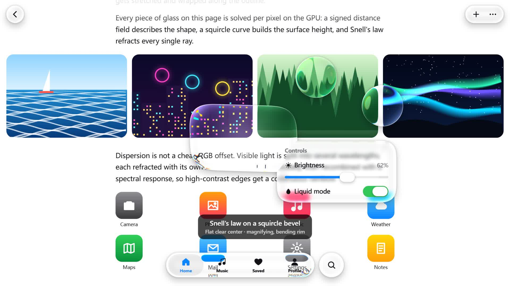](docs/media/demo.mp4)

<sub>画像をクリックすると 45 秒のデモ動画（1080p）を再生します。</sub>

</div>

---

## なぜまた Liquid Glass なのか

Web 上の「リキッドグラス」の多くは、ぼかし＋白い枠線（せいぜい RGB ずらし）です。それはグラスモーフィズムであってガラスではありません。
Apple の素材は**レンズ**です。平らな中央は透明なまま、湾曲した縁が光を曲げて集めるので、背後のコンテンツが輪郭に沿って引き伸ばされ、回り込みます。このプロジェクトはその光学をピクセルごとに解いています。

| よくある「AI 製リキッドグラス」 | 本プロジェクト |
|---|---|
| `backdrop-filter: blur()` + 枠線 | スクワークル断面のベゼルを通るスネル屈折 |
| RGB チャンネルずらし | 7〜16 波長を個別に屈折し、分光応答で再合成 |
| 白いハイライトを重ねるだけ | 光源側の縁ハイライト＋反対側の内部反射、色はコンテンツから（OKLab） |
| 固定の見た目 | ライト／ダーク適応、フレネル縁反射、接触影、液体融合、タッチ発光、ゼリー物理 |

<p align="center">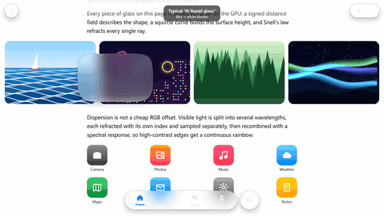</p>

## 機能

<table>
<tr>
<td width="50%">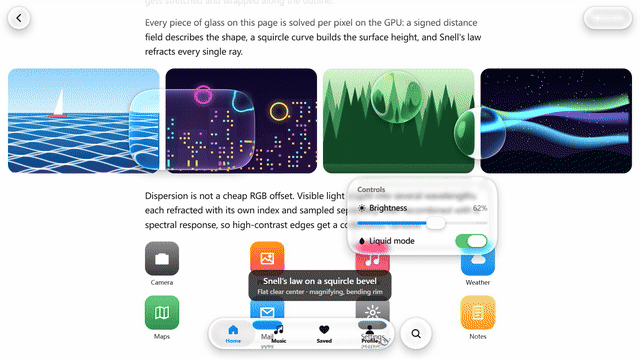<br><b>レンズ効果。</b>中央は透明、縁は拡大。文字が輪郭に沿って曲がります。</td>
<td width="50%">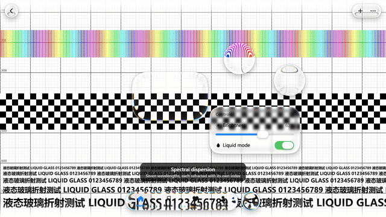<br><b>スペクトル分散。</b>高コントラストの縁に連続した虹色のフリンジ。</td>
</tr>
<tr>
<td>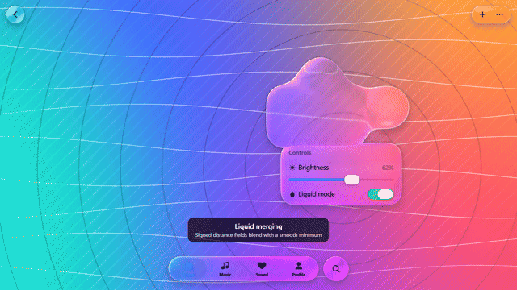<br><b>液体融合。</b>符号付き距離場をスムーズ最小値で合成。</td>
<td>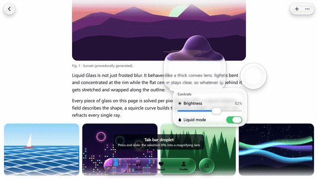<br><b>タブバーの雫。</b>選択が持ち上がり、下のガラスごと拡大するレンズに。</td>
</tr>
<tr>
<td>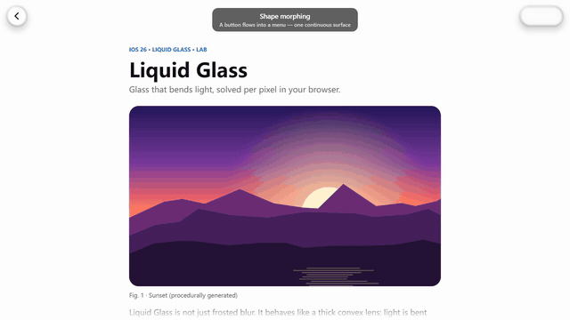<br><b>モーフィング。</b>ボタンが一続きの面としてメニューに変形。</td>
<td>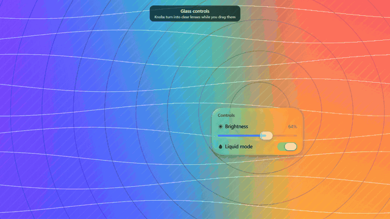<br><b>ガラスのコントロール。</b>ドラッグ中はスライダー／スイッチのノブが透明レンズに。</td>
</tr>
<tr>
<td>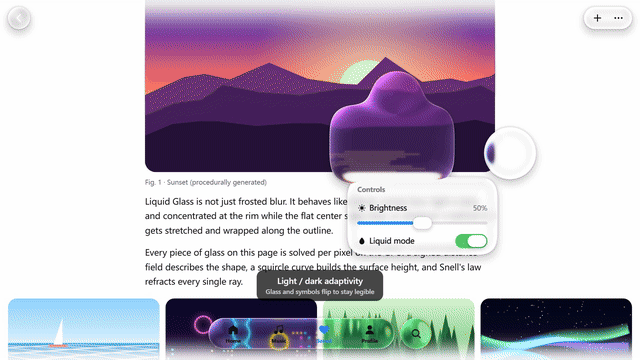<br><b>ライト／ダーク適応。</b>常に読みやすいようガラスとアイコンが切り替わります。</td>
<td>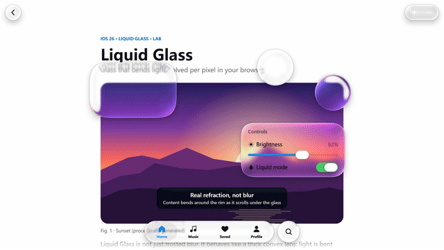<br><b>ガラスの下をスクロール。</b>iOS 風の慣性、ラバーバンド、スクロールエッジ。</td>
</tr>
</table>

## Apple との照合

3 つの見た目があります：**Regular**（ほとんどのバーやボタン、強いぼかし＋乳白のベール）、**Clear**（写真・動画の上、中程度のぼかし、ベールなし）、**Crystal**（iOS 27 の Siri、完全に透明なドーム、虹色の帯）。プリセット `regular`・`clear`・`crystal` に対応します。

<p align="center">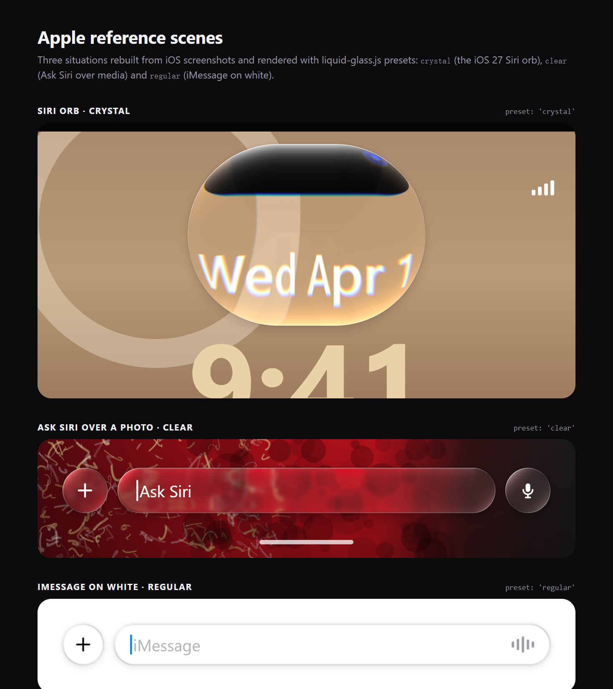</p>

## 仕組み

1. **形状**：超楕円コーナーの角丸矩形 SDF（`R = 1.528·r`、`n ≈ 3.25` ≈ iOS の連続曲率コーナー）。同じグループはスムーズ最小値で結合。
2. **表面**：縁の高さは凸スクワークル `h(x) = ⁴√(1 − (1 − x)⁴)`。
3. **屈折**：視線をスネルの法則で屈折させ背景平面まで進める：`offset = R.xy / −R.z · (h · thickness + base)`。
4. **分散**：N 波長それぞれで屈折し、正規化した分光応答で重み付け。
5. **フロスト**：ガウシアンピラミッド＋B スプライン双三次サンプリング。
6. **ライティング**：ビブランシー、適応ベール、屈折した接触影、シュリック近似のフレネル、OKLab のグレア、縁のライン、タッチ発光。
7. **影**：柔らかいドロップシャドウ＋縁のアンビエント。

## 自分のサイトで使う

ライブラリ：[`dist/liquid-glass.js`](dist/liquid-glass.js)（UMD、約 84 KB、依存なし）。

```html

<nav class="glass-nav">…</nav>
<script src="liquid-glass.js"></script>
<script>
  const lg = LiquidGlass.create({ background: '#hero-bg', preset: 'auto' });   // WebGL エンジン
  lg.add('.glass-nav', { role: 'navbar' });
</script>
```

```js
LiquidGlass.create({ engine: 'dom' }).add('header', { role: 'navbar', surface: 'text' });   // DOM エンジン（Chromium で本物の屈折）
LiquidGlass.recommend({ surface: 'photo', brightness: 0.3, busyness: 0.7, role: 'navbar', size: { w: 390, h: 62 } });
```

**アニメーション内蔵**：押下時のスプリング拡大、指に追従するドラッグ、ゼリーのような伸縮、慣性で投げる、境界のラバーバンド、スナップ、液体融合、タブバーの雫——`lg.add(el, { draggable: true })`、`lg.tabbar('.tabbar')`。

<p align="center">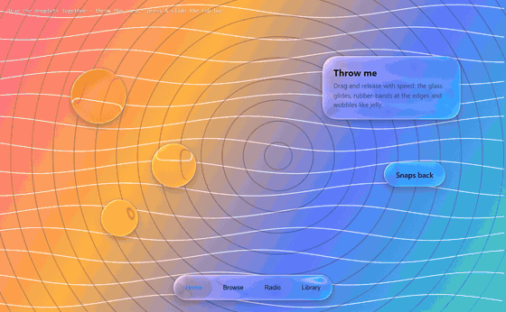</p>

ガラス要素には `data-lg-tone` と CSS 変数 `--lg-fg` が付くので、`color: var(--lg-fg)` で文字色が背景に追従します。サンプル：
[ヒーロー（WebGL）](skills/liquid-glass/examples/hero-webgl.html) · [ナビバー（DOM）](skills/liquid-glass/examples/navbar-dom.html) · [recommend() プレイグラウンド](skills/liquid-glass/examples/auto-tune.html)

## AI スキル

[`skills/liquid-glass`](skills/liquid-glass) を入れると、AI コーディングアシスタントがシーン（ガラスの背後に何があるか、明るさ、情報量、要素の種類）を見て、屈折率・厚み・ベゼル・フロスト・分散・色を明示的なルールで選び、サイトに組み込みます。

```bash
cp -r skills/liquid-glass ~/.claude/skills/     # 個人
cp -r skills/liquid-glass .claude/skills/       # プロジェクト
```

あとは「ナビバーとフローティングボタンをリキッドグラスにして」と頼むだけです。

## ローカルで実行

```bash
git clone https://github.com/lzq20121022-tech/the-best-liquid-glass.git
cd the-best-liquid-glass
python -m http.server 5178
```

`npm run build`（ライブラリ）· `npm run record`（動画と GIF）· `npm run assets`（スクリーンショット）

## 対応ブラウザ

WebGL2 が必要です。デモと WebGL エンジンは Chrome / Edge / Safari 15+ / Firefox。DOM エンジンは Chromium で本物の屈折、Safari・Firefox ではフロストにフォールバック。

## 参考

Apple Liquid Glass 概要と WWDC25「Meet Liquid Glass」· [kube.io](https://kube.io/blog/liquid-glass-css-svg/) · [Liquid Glass Studio](https://github.com/iyinchao/liquid-glass-studio) · Jorge Jimenez の 13-tap ダウンサンプル · [OKLab](https://bottosson.github.io/posts/oklab/)

Liquid Glass は Apple Inc. の商標です。本プロジェクトは独立した実装であり、Apple とは関係ありません。

## ライセンス

[MIT](LICENSE) © lzq20121022-tech
