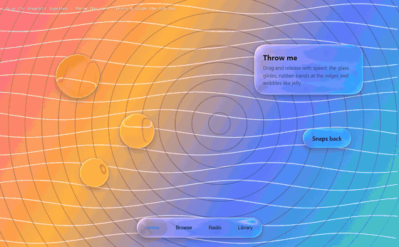

<div align="center">

# The Best Liquid Glass

[English](README.md) · [简体中文](README.zh-CN.md) · [繁體中文](README.zh-TW.md) · [日本語](README.ja.md) · **한국어** · [Español](README.es.md)

Apple **Liquid Glass**를 웹에서 **물리 기반·실시간**으로 재현합니다 —
곡면 베젤에서의 실제 스넬 굴절, 스펙트럼 분산, 프레넬 반사, 콘텐츠 색을 띠는 스페큘러, 액체처럼 합쳐지는 모양, 라이트/다크 적응. 순수 WebGL2, 의존성 없음.

**[▶ 라이브 데모](https://the-best-liquid-glass.pages.dev)** · [데모 영상](docs/media/demo.mp4) · [내 사이트에 적용하기](#내-사이트에-적용하기) · [AI 스킬](#ai-스킬)

[](docs/media/demo.mp4)

<sub>이미지를 클릭하면 45초 데모 영상(1080p)이 재생됩니다.</sub>

</div>

---

## 왜 또 리퀴드 글래스인가

웹의 "리퀴드 글래스"는 대부분 블러 + 흰 테두리(기껏해야 RGB 분리)입니다. 그것은 글래스모피즘이지 유리가 아닙니다.
Apple의 소재는 **렌즈**입니다. 평평한 가운데는 투명하게 유지되고 휘어진 가장자리가 빛을 굴절·집중시켜, 뒤의 콘텐츠가 윤곽을 따라 늘어나고 감싸집니다. 이 프로젝트는 그 광학을 픽셀 단위로 계산합니다.

| 흔한 "AI 리퀴드 글래스" | 이 프로젝트 |
|---|---|
| `backdrop-filter: blur()` + 테두리 | 스쿼클 단면 베젤을 통과하는 스넬 굴절 |
| RGB 채널 오프셋 | 7–16개 파장을 각각 굴절시키고 분광 응답으로 재합성 |
| 흰 하이라이트 오버레이 | 광원 쪽 림 하이라이트 + 반대쪽 내부 반사, 색은 콘텐츠에서(OKLab) |
| 고정된 모습 | 라이트/다크 적응, 프레넬 가장자리 반사, 접촉 그림자, 액체 병합, 터치 발광, 젤리 물리 |

<p align="center"></p>

## 기능

<table>
<tr>
<td width="50%"><br><b>렌즈 효과.</b> 가운데는 투명, 가장자리는 확대. 글자가 윤곽을 따라 휩니다.</td>
<td width="50%"><br><b>스펙트럼 분산.</b> 고대비 가장자리에 연속적인 무지개 프린지.</td>
</tr>
<tr>
<td><br><b>액체 병합.</b> 부호 거리장을 스무스 최소값으로 합성.</td>
<td><br><b>탭 바 물방울.</b> 선택 항목이 떠올라 아래 유리까지 굴절시키는 렌즈가 됩니다.</td>
</tr>
<tr>
<td><br><b>모핑.</b> 버튼이 하나의 연속된 면으로 메뉴가 됩니다.</td>
<td><br><b>유리 컨트롤.</b> 드래그하는 동안 슬라이더/스위치 노브가 투명 렌즈로.</td>
</tr>
<tr>
<td><br><b>라이트/다크 적응.</b> 항상 읽기 쉽도록 유리와 아이콘이 전환됩니다.</td>
<td><br><b>유리 아래 스크롤.</b> iOS식 관성, 러버밴드, 스크롤 가장자리 효과.</td>
</tr>
</table>

## 원리

1. **형태**: 초타원 모서리를 가진 둥근 사각형 SDF(`R = 1.528·r`, `n ≈ 3.25` ≈ iOS 연속 곡률 모서리). 같은 그룹은 스무스 최소값으로 연결.
2. **표면**: 가장자리 높이는 볼록 스쿼클 `h(x) = ⁴√(1 − (1 − x)⁴)`.
3. **굴절**: 시선을 스넬 법칙으로 굴절시켜 배경 평면까지 진행: `offset = R.xy / −R.z · (h · thickness + base)`.
4. **분산**: N개 파장마다 굴절하고 정규화된 분광 응답으로 가중.
5. **프로스트**: 가우시안 피라미드 + B-스플라인 바이큐빅 샘플링.
6. **조명**: 비브런시, 적응형 베일, 굴절된 접촉 그림자, 슐릭 프레넬, OKLab 글레어, 림 라인, 터치 발광.
7. **그림자**: 부드러운 드롭 섀도 + 가장자리 앰비언트.

## 내 사이트에 적용하기

라이브러리: [`dist/liquid-glass.js`](dist/liquid-glass.js) (UMD, 약 84 KB, 의존성 없음).

```html

<nav class="glass-nav">…</nav>
<script src="liquid-glass.js"></script>
<script>
  const lg = LiquidGlass.create({ background: '#hero-bg', preset: 'auto' });   // WebGL 엔진
  lg.add('.glass-nav', { role: 'navbar' });
</script>
```

```js
LiquidGlass.create({ engine: 'dom' }).add('header', { role: 'navbar', surface: 'text' });   // DOM 엔진(Chromium에서 실제 굴절)
LiquidGlass.recommend({ surface: 'photo', brightness: 0.3, busyness: 0.7, role: 'navbar', size: { w: 390, h: 62 } });
```

**애니메이션 내장**: 누를 때 스프링 확대, 손가락을 따라오는 드래그, 젤리 같은 늘어남, 관성 던지기, 경계 러버밴드, 스냅, 액체 병합, 탭 바 물방울 — `lg.add(el, { draggable: true })`, `lg.tabbar('.tabbar')`.

<p align="center"></p>

유리 요소에는 `data-lg-tone`과 CSS 변수 `--lg-fg`가 설정되므로 `color: var(--lg-fg)`로 글자색이 배경을 따라갑니다. 예제:
[히어로(WebGL)](skills/liquid-glass/examples/hero-webgl.html) · [내비게이션 바(DOM)](skills/liquid-glass/examples/navbar-dom.html) · [recommend() 플레이그라운드](skills/liquid-glass/examples/auto-tune.html)

## AI 스킬

[`skills/liquid-glass`](skills/liquid-glass)를 설치하면 AI 코딩 어시스턴트가 장면(유리 뒤에 무엇이 있는지, 밝기, 복잡도, 요소 종류)을 보고 굴절률·두께·베젤·프로스트·분산·색조를 명확한 규칙으로 고른 뒤 사이트에 통합합니다.

```bash
cp -r skills/liquid-glass ~/.claude/skills/     # 개인
cp -r skills/liquid-glass .claude/skills/       # 프로젝트
```

그다음 "내비게이션 바와 플로팅 버튼을 리퀴드 글래스로 만들어 줘"라고 요청하세요.

## 로컬 실행

```bash
git clone https://github.com/lzq20121022-tech/the-best-liquid-glass.git
cd the-best-liquid-glass
python -m http.server 5178
```

`npm run build`(라이브러리) · `npm run record`(영상과 GIF) · `npm run assets`(스크린샷)

## 브라우저 지원

WebGL2가 필요합니다. 데모와 WebGL 엔진은 Chrome / Edge / Safari 15+ / Firefox, DOM 엔진은 Chromium에서 실제 굴절, Safari·Firefox에서는 프로스트로 대체됩니다.

## 참고

Apple Liquid Glass 개요와 WWDC25 "Meet Liquid Glass" · [kube.io](https://kube.io/blog/liquid-glass-css-svg/) · [Liquid Glass Studio](https://github.com/iyinchao/liquid-glass-studio) · Jorge Jimenez 13-tap 다운샘플 · [OKLab](https://bottosson.github.io/posts/oklab/)

Liquid Glass는 Apple Inc.의 상표입니다. 이 프로젝트는 독립적인 구현이며 Apple과 관련이 없습니다.

## 라이선스

[MIT](LICENSE) © lzq20121022-tech
