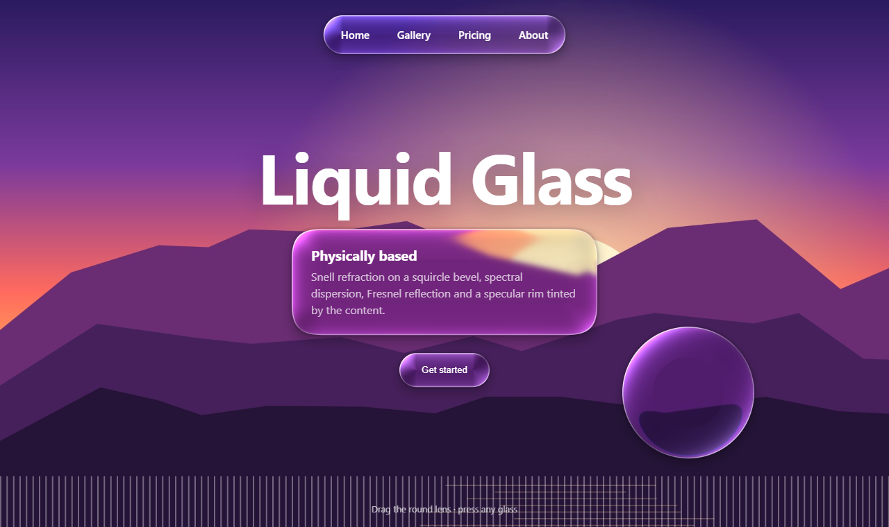

<div align="center">

# The Best Liquid Glass

**English** · [简体中文](README.zh-CN.md) · [繁體中文](README.zh-TW.md) · [日本語](README.ja.md) · [한국어](README.ko.md) · [Español](README.es.md)

A physically based, real-time recreation of Apple's **Liquid Glass** for the web —
real Snell refraction on a curved bevel, spectral dispersion, Fresnel reflection, content‑tinted specular light,
liquid merging and light/dark adaptivity. Pure WebGL2, zero dependencies.

**[▶ Live demo](https://the-best-liquid-glass.pages.dev)** · [Demo video](docs/media/demo.mp4) · [Use it on your site](#use-it-on-your-site) · [AI skill](#ai-skill-let-your-ai-apply-it)

[](docs/media/demo.mp4)

<sub>Click the image to play the 45‑second demo video (1080p).</sub>

</div>

---

## Why another liquid glass?

Most "liquid glass" on the web is a blur, a white border and maybe an RGB split. That is glassmorphism, not glass.
Apple's material is a **lens**: the flat center stays clear while the curved rim bends and concentrates light,
so content behind it stretches and wraps around the outline. This project solves that optics per pixel.

| Typical "AI liquid glass" | This project |
|---|---|
| `backdrop-filter: blur()` + border | Snell refraction through a squircle‑profiled bevel |
| RGB channel offset | 7–16 wavelengths refracted separately, recombined with a spectral response |
| White highlight overlay | Specular rim facing the light + far‑side internal reflection, colored by the content (OKLab) |
| Invisible on white | The shadow under the glass is refracted into the rim → the curved grey inner ring that makes glass read as thick |
| Fixed look | Light/dark adaptivity, Fresnel edge reflection, liquid merging, touch glow, jelly physics |

<p align="center"></p>

## Features

<table>
<tr>
<td width="50%"><br><b>Lensing.</b> Flat clear center, magnifying rim. Text bends around the outline.</td>
<td width="50%"><br><b>Spectral dispersion.</b> Continuous rainbow fringes on high‑contrast edges.</td>
</tr>
<tr>
<td><br><b>Liquid merging.</b> Signed distance fields blended with a smooth minimum.</td>
<td><br><b>Tab bar droplet.</b> The selection lifts into a magnifying lens that refracts the glass below it.</td>
</tr>
<tr>
<td><br><b>Morphing.</b> A button flows into a menu as one continuous surface.</td>
<td><br><b>Glass controls.</b> Slider and switch knobs turn into clear lenses while dragged.</td>
</tr>
<tr>
<td><br><b>Adaptivity.</b> Glass and symbols flip between light and dark to stay legible.</td>
<td><br><b>Scroll under glass.</b> iOS‑style momentum, rubber banding and scroll‑edge fade.</td>
</tr>
</table>

The demo also includes a full parameter panel (IOR, thickness, bezel, dispersion, frost, light, shadow, merging…),
debug views (SDF, normals, displacement field, height map), a comparison mode (hold <kbd>Space</kbd>),
gyroscope‑driven highlights on phones, and your own image or video as the background.

## How it works

```
scene ──► 13‑tap downsample ×6 (blur pyramid) ──► base glass pass ──► top glass pass ──► screen
 (text / grid / wallpaper / photo / video)         bars, lens, panels    droplet & knobs refract the base pass
```

For every pixel inside a glass shape:

1. **Shape** — a signed distance field of a rounded rectangle with superellipse corners
   (`R = 1.528·r`, `n ≈ 3.25` ≈ iOS continuous corners). Shapes in one group are joined with a smooth minimum → liquid merging.
2. **Surface** — height along the rim follows a convex squircle `h(x) = ⁴√(1 − (1 − x)⁴)`, `x = distance inside / bezel`.
   The normal is `normalize(∇sdf · h′(x) · thickness / bezel, 1)`.
3. **Refraction** — the view ray `(0, 0, −1)` is refracted with Snell's law (`refract(I, N, 1/ior)`) and travels down
   to the background plane: `offset = R.xy / −R.z · (h · thickness + base)`.
4. **Dispersion** — steps 3–4 run for N wavelengths with `ior(λ) = ior + disp · (t − ½)`; samples are weighted by
   per‑channel spectral responses normalized so white stays white.
5. **Frost** — sampled from a Gaussian pyramid with B‑spline bicubic filtering and continuous level interpolation.
6. **Light** — the contact shadow under the glass refracted into the rim, vibrancy, adaptive veil, Schlick Fresnel that mirrors outside content into the edge, glare in OKLab
   (brightens the content color instead of painting white), a thin rim line (near side strong, far side weaker), touch glow.
7. **Shadow** — a soft drop shadow plus a tight ambient edge, evaluated from the same SDF.

## Use it on your site

The same renderer ships as a drop‑in library: [`dist/liquid-glass.js`](dist/liquid-glass.js) (UMD, ~66 KB, no dependencies).

**Glass on an image / video / canvas / gradient (WebGL engine, every modern browser):**

```html
<section class="hero">
  
  <nav class="glass-nav">…</nav>
  <button class="glass-btn">Get started</button>
</section>

<script src="liquid-glass.js"></script>
<script>
  const lg = LiquidGlass.create({ background: '#hero-bg', preset: 'auto' });
  lg.add('.glass-nav', { role: 'navbar' });
  lg.add('.glass-btn', { role: 'button' });
</script>
```

**Glass over live page content (DOM engine):** real refraction through SVG `backdrop-filter` in Chromium
(Chrome, Edge, Opera, Arc, Brave), automatic frosted fallback in Safari and Firefox.

```js
const lg = LiquidGlass.create({ engine: 'dom' });
lg.add('header', { role: 'navbar', surface: 'text' });
```

**Let the library choose parameters for a scene:**

```js
LiquidGlass.recommend({ surface: 'photo', brightness: 0.3, busyness: 0.7, role: 'navbar', size: { w: 390, h: 62 } });
// → { params: { frost: 6, disp: 0.1, bezel: 24, thickness: 28, rimI: 0.62, ... }, tone: 'dark', material: 'regular' }
```

Glass elements get `data-lg-tone="light|dark"` and the CSS variables `--lg-fg` / `--lg-fg-2`, so text inside can
follow the background: `color: var(--lg-fg)`. Runnable examples:
[hero (WebGL)](skills/liquid-glass/examples/hero-webgl.html) ·
[navbar over a page (DOM)](skills/liquid-glass/examples/navbar-dom.html) ·
[recommend() playground](skills/liquid-glass/examples/auto-tune.html).

<p align="center"></p>

## AI skill: let your AI apply it

[`skills/liquid-glass`](skills/liquid-glass) is an agent skill. Your AI coding assistant reads the scene
(what is behind the glass, how bright and busy it is, what the element is), picks IOR, thickness, bezel, frost,
dispersion and tint with explicit rules, and integrates the library into your site.

```bash
# Claude Code (personal skills)
cp -r skills/liquid-glass ~/.claude/skills/
# or per project
cp -r skills/liquid-glass .claude/skills/
```

Then just ask: *"Make the navbar and the floating buttons liquid glass."*
The skill contains [`SKILL.md`](skills/liquid-glass/SKILL.md) (workflow),
[`references/parameters.md`](skills/liquid-glass/references/parameters.md) (every parameter, physically explained),
[`references/recipes.md`](skills/liquid-glass/references/recipes.md) (scene → parameter recipes) and the library itself.
It works with any agent that understands `SKILL.md` folders; for others, point the AI at `SKILL.md`.

## Run locally

```bash
git clone https://github.com/lzq20121022-tech/the-best-liquid-glass.git
cd the-best-liquid-glass
python -m http.server 5178        # or any static server
# open http://localhost:5178
```

No build step for the demo. Other scripts (`npm install` first):

| Command | What it does |
|---|---|
| `npm run build` | Rebuilds `dist/liquid-glass.js` and the skill copy from `src/` + the demo's shaders |
| `npm run record` | Records `docs/media/demo.mp4` and the GIFs with headless Chrome (deterministic, frame by frame) |
| `npm run assets` | Regenerates screenshots and the example photo |

URL options: `?lang=en|zh` · `?timer` (setTimeout loop for throttled windows) · `?record` (frame‑stepped recording mode).

## Browser support

| | Demo & WebGL engine | DOM engine |
|---|---|---|
| Chrome / Edge / Opera / Arc | ✅ | ✅ real refraction |
| Safari 15+ (macOS, iOS) | ✅ | Frosted fallback |
| Firefox | ✅ | Frosted fallback |

Requires WebGL2. Shortcuts in the demo: <kbd>Space</kbd> compare · <kbd>P</kbd> panel · <kbd>D</kbd> debug views.

## Project structure

```
index.html, style.css, js/        the demo (shaders, scenes, physics, panel, i18n)
src/liquid-glass.src.js           library source
dist/liquid-glass.js              built library
skills/liquid-glass/              AI skill: SKILL.md, references, examples, library copy
tools/                            build, recording and asset scripts
docs/media/                       video, GIFs, screenshots
```

## References

- Apple — Liquid Glass overview and the WWDC25 session *Meet Liquid Glass*
- Chris Feijoo — [Liquid Glass in the browser: refraction with CSS and SVG](https://kube.io/blog/liquid-glass-css-svg/) (surface profiles, Snell displacement maps)
- [Liquid Glass Studio](https://github.com/iyinchao/liquid-glass-studio) (SDF merging, edge factors)
- Jorge Jimenez — *Next Generation Post Processing in Call of Duty: Advanced Warfare* (13‑tap downsample)
- Björn Ottosson — [OKLab](https://bottosson.github.io/posts/oklab/)

Liquid Glass is a trademark of Apple Inc. This is an independent, from‑scratch implementation and is not affiliated with Apple.

## License

[MIT](LICENSE) © lzq20121022-tech
