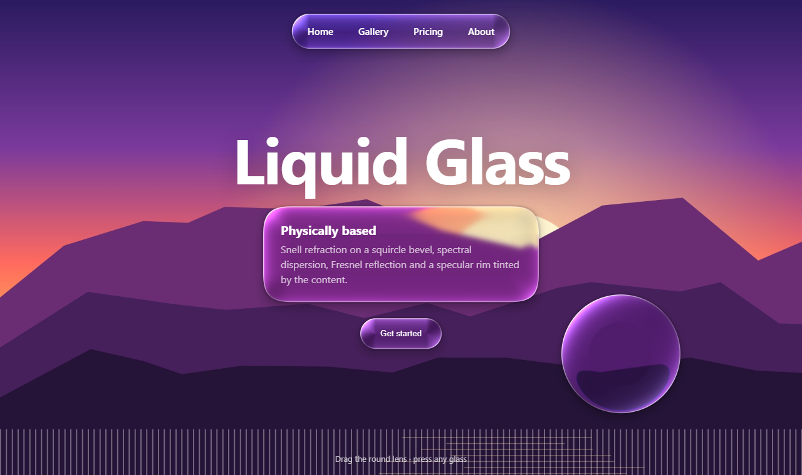

<div align="center">

# The Best Liquid Glass · 最好的液态玻璃

[English](README.md) · **简体中文** · [繁體中文](README.zh-TW.md) · [日本語](README.ja.md) · [한국어](README.ko.md) · [Español](README.es.md)

在网页上**基于物理、实时**还原苹果 **Liquid Glass（液态玻璃）**——
弧面上的真实斯涅尔折射、光谱色散、Fresnel 反射、取色高光、液体融合、明暗自适应。纯 WebGL2，零依赖。

**[▶ 在线演示](https://the-best-liquid-glass.pages.dev)** · [演示视频](docs/media/demo.mp4) · [用在你的网站上](#用在你的网站上) · [AI Skill](#ai-skill让-ai-直接帮你用上)

[](docs/media/demo.mp4)

<sub>点击图片播放 45 秒演示视频（1080p）。</sub>

</div>

---

## 为什么还要再做一个液态玻璃？

网上大多数"液态玻璃"只是一层模糊 + 一圈白边，顶多再加个 RGB 错位——那是毛玻璃，不是玻璃。
苹果的材质本质上是一块**透镜**：平坦的中心保持清澈，弯曲的边缘把光线弯折、汇聚，背后的内容会沿着轮廓被拉伸、包裹。本项目逐像素求解了这套光学。

| 常见的"AI 液态玻璃" | 本项目 |
|---|---|
| `backdrop-filter: blur()` + 边框 | 光线穿过 squircle 剖面弧面的斯涅尔折射 |
| RGB 通道错位 | 7–16 个波长分别折射，按光谱响应重新合成 |
| 叠一层白色高光 | 迎光侧边缘高光 + 背光侧内部反射光，颜色取自下方内容（OKLab） |
| 白底上几乎隐形 | 玻璃脚下的阴影被折射进弧面 → 边缘内侧弯曲的灰色环，玻璃才显得“厚” |
| 效果固定 | 明暗自适应、Fresnel 边缘反射、液体融合、触摸发光、果冻物理 |

<p align="center"></p>

## 功能

<table>
<tr>
<td width="50%"><br><b>透镜折射。</b>中心清澈、边缘放大，文字沿轮廓弯曲。</td>
<td width="50%"><br><b>光谱色散。</b>高对比边缘上出现连续的彩虹色边。</td>
</tr>
<tr>
<td><br><b>液体融合。</b>有符号距离场用平滑最小值混合。</td>
<td><br><b>标签栏水滴。</b>选中项抬起成放大镜，并折射它下面那层玻璃。</td>
</tr>
<tr>
<td><br><b>形状变形。</b>按钮连续地流动成菜单。</td>
<td><br><b>玻璃控件。</b>拖动时滑块/开关的旋钮变成透明透镜。</td>
</tr>
<tr>
<td><br><b>明暗自适应。</b>玻璃与图标在深浅之间切换，始终清晰。</td>
<td><br><b>内容在玻璃下滚动。</b>iOS 式惯性、橡皮筋回弹与滚动边缘渐隐。</td>
</tr>
</table>

演示页还包含完整的参数面板（折射率、厚度、弧面宽度、色散、磨砂、光源、阴影、融合……）、调试视图（SDF、法线、位移场、高度图）、对照模式（按住 <kbd>空格</kbd>）、手机陀螺仪驱动的高光，以及使用你自己的图片或视频作为背景。

## 原理

```
场景 ──► 13-tap 降采样 ×6（模糊金字塔）──► 底层玻璃 pass ──► 顶层玻璃 pass ──► 屏幕
（图文 / 网格 / 壁纸 / 照片 / 视频）     标签栏、透镜、面板     水滴与旋钮折射底层的结果
```

对玻璃内的每个像素：

1. **形状** —— 带超椭圆圆角的圆角矩形 SDF（`R = 1.528·r`、`n ≈ 3.25`，逼近 iOS 连续曲率圆角）。同组形状用平滑最小值连接 → 液体融合。
2. **表面** —— 边缘高度遵循凸面 squircle：`h(x) = ⁴√(1 − (1 − x)⁴)`，`x = 向内距离 / 弧面宽度`。法线 `normalize(∇sdf · h′(x) · 厚度 / 弧面宽度, 1)`。
3. **折射** —— 视线 `(0, 0, −1)` 按斯涅尔定律折射（`refract(I, N, 1/ior)`），一直传播到背景平面：`偏移 = R.xy / −R.z · (h · 厚度 + 底座)`。
4. **色散** —— 对 N 个波长重复第 3 步，`ior(λ) = ior + disp · (t − ½)`；采样按归一化的分通道光谱响应加权，白色仍是白色。
5. **磨砂** —— 从高斯金字塔中用 B 样条双三次滤波采样，层级之间连续插值。
6. **光照** —— 被折射进弧面的接触阴影、通透感、自适应薄纱、把外侧内容镜像进边缘的 Schlick Fresnel、在 OKLab 中提亮内容颜色的眩光（而不是刷白）、迎光强/背光弱的边缘细线、触摸发光。
7. **阴影** —— 柔和投影 + 紧贴边缘的环境遮蔽，由同一个 SDF 计算。

## 用在你的网站上

同一套渲染器打包成了即插即用的库：[`dist/liquid-glass.js`](dist/liquid-glass.js)（UMD，约 66 KB，无依赖）。

**玻璃在图片 / 视频 / canvas / 渐变之上（WebGL 引擎，所有现代浏览器）：**

```html
<section class="hero">
  
  <nav class="glass-nav">…</nav>
  <button class="glass-btn">开始使用</button>
</section>

<script src="liquid-glass.js"></script>
<script>
  const lg = LiquidGlass.create({ background: '#hero-bg', preset: 'auto' });
  lg.add('.glass-nav', { role: 'navbar' });
  lg.add('.glass-btn', { role: 'button' });
</script>
```

**玻璃在实时网页内容之上（DOM 引擎）：** Chromium 内核（Chrome、Edge、Opera、Arc、Brave）通过 SVG `backdrop-filter` 实现真折射，Safari 与 Firefox 自动降级为磨砂。

```js
const lg = LiquidGlass.create({ engine: 'dom' });
lg.add('header', { role: 'navbar', surface: 'text' });
```

**让库根据场景自动选择参数：**

```js
LiquidGlass.recommend({ surface: 'photo', brightness: 0.3, busyness: 0.7, role: 'navbar', size: { w: 390, h: 62 } });
// → { params: { frost: 6, disp: 0.1, bezel: 24, thickness: 28, rimI: 0.62, ... }, tone: 'dark', material: 'regular' }
```

玻璃元素会获得 `data-lg-tone="light|dark"` 以及 CSS 变量 `--lg-fg` / `--lg-fg-2`，里面的文字写 `color: var(--lg-fg)` 就能跟随背景自动变色。可运行示例：
[主图（WebGL）](skills/liquid-glass/examples/hero-webgl.html) ·
[网页上的导航栏（DOM）](skills/liquid-glass/examples/navbar-dom.html) ·
[recommend() 调参台](skills/liquid-glass/examples/auto-tune.html)。

<p align="center"></p>

## AI Skill：让 AI 直接帮你用上

[`skills/liquid-glass`](skills/liquid-glass) 是一个 AI Skill。你的 AI 编程助手会先看场景（玻璃后面是什么、多亮、多复杂、是什么控件），按明确的规则选出折射率、厚度、弧面宽度、磨砂、色散和着色，再把库集成进你的网站。

```bash
# Claude Code（个人 skill）
cp -r skills/liquid-glass ~/.claude/skills/
# 或者只给当前项目
cp -r skills/liquid-glass .claude/skills/
```

然后直接说：*"把导航栏和悬浮按钮做成液态玻璃。"*
Skill 包含 [`SKILL.md`](skills/liquid-glass/SKILL.md)（工作流程）、[`references/parameters.md`](skills/liquid-glass/references/parameters.md)（每个参数的物理含义）、[`references/recipes.md`](skills/liquid-glass/references/recipes.md)（场景 → 参数配方）和库本身。任何支持 `SKILL.md` 目录的智能体都能用；其他 AI 让它读 `SKILL.md` 即可。

## 本地运行

```bash
git clone https://github.com/lzq20121022-tech/the-best-liquid-glass.git
cd the-best-liquid-glass
python -m http.server 5178        # 或任意静态服务器
# 打开 http://localhost:5178
```

演示页无需构建。其他脚本（先 `npm install`）：

| 命令 | 作用 |
|---|---|
| `npm run build` | 由 `src/` 与演示页着色器重新构建 `dist/liquid-glass.js` 和 Skill 中的副本 |
| `npm run record` | 用无头 Chrome 逐帧确定性录制 `docs/media/demo.mp4` 与 GIF |
| `npm run assets` | 重新生成截图和示例照片 |

URL 参数：`?lang=en|zh` · `?timer`（窗口被节流时用 setTimeout 驱动）· `?record`（逐帧录制模式）。

## 浏览器支持

| | 演示页与 WebGL 引擎 | DOM 引擎 |
|---|---|---|
| Chrome / Edge / Opera / Arc | ✅ | ✅ 真折射 |
| Safari 15+（macOS、iOS） | ✅ | 磨砂降级 |
| Firefox | ✅ | 磨砂降级 |

需要 WebGL2。快捷键：<kbd>空格</kbd> 对照 · <kbd>P</kbd> 面板 · <kbd>D</kbd> 调试视图。

## 目录结构

```
index.html, style.css, js/        演示页（着色器、场景、物理、面板、多语言）
src/liquid-glass.src.js           库源码
dist/liquid-glass.js              构建后的库
skills/liquid-glass/              AI Skill：SKILL.md、参考文档、示例、库副本
tools/                            构建、录制与素材脚本
docs/media/                       视频、GIF、截图
```

## 参考资料

- Apple —— Liquid Glass 概览与 WWDC25《Meet Liquid Glass》
- Chris Feijoo —— [Liquid Glass in the browser: refraction with CSS and SVG](https://kube.io/blog/liquid-glass-css-svg/)（表面剖面、斯涅尔位移贴图）
- [Liquid Glass Studio](https://github.com/iyinchao/liquid-glass-studio)（SDF 融合、边缘系数）
- Jorge Jimenez —— *Next Generation Post Processing in Call of Duty: Advanced Warfare*（13-tap 降采样）
- Björn Ottosson —— [OKLab](https://bottosson.github.io/posts/oklab/)

Liquid Glass 是 Apple Inc. 的商标。本项目为独立、从零实现，与 Apple 无关。

## 许可证

[MIT](LICENSE) © lzq20121022-tech
