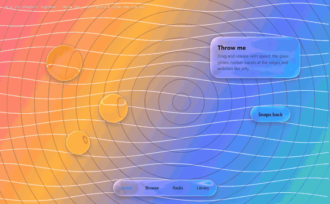

<div align="center">

# The Best Liquid Glass · 最好的液態玻璃

[English](README.md) · [简体中文](README.zh-CN.md) · **繁體中文** · [日本語](README.ja.md) · [한국어](README.ko.md) · [Español](README.es.md)

在網頁上**基於物理、即時**重現 Apple 的 **Liquid Glass（液態玻璃）**——
弧面上的真實司乃耳折射、光譜色散、Fresnel 反射、取色高光、液體融合、明暗自適應。純 WebGL2，零依賴。

**[▶ 線上展示](https://the-best-liquid-glass.pages.dev)** · [展示影片](docs/media/demo.mp4) · [用在你的網站](#用在你的網站) · [AI Skill](#ai-skill讓-ai-直接幫你套用)

[](docs/media/demo.mp4)

<sub>點擊圖片播放 45 秒展示影片（1080p）。</sub>

</div>

---

## 為什麼還要再做一個液態玻璃？

網路上大多數「液態玻璃」只是一層模糊加一圈白邊，頂多再來個 RGB 錯位——那是毛玻璃，不是玻璃。
Apple 的材質本質上是一片**透鏡**：平坦的中心保持清澈，彎曲的邊緣把光線彎折、匯聚，背後的內容沿著輪廓被拉伸、包覆。本專案逐像素求解了這套光學。

| 常見的「AI 液態玻璃」 | 本專案 |
|---|---|
| `backdrop-filter: blur()` + 邊框 | 光線穿過 squircle 剖面弧面的司乃耳折射 |
| RGB 通道錯位 | 7–16 個波長分別折射，依光譜響應重新合成 |
| 疊一層白色高光 | 迎光側邊緣高光 + 背光側內部反射，顏色取自下方內容（OKLab） |
| 效果固定 | 明暗自適應、Fresnel 邊緣反射、接觸陰影、液體融合、觸控發光、果凍物理 |

<p align="center"></p>

## 功能

<table>
<tr>
<td width="50%"><br><b>透鏡折射。</b>中心清澈、邊緣放大，文字沿輪廓彎曲。</td>
<td width="50%"><br><b>光譜色散。</b>高對比邊緣出現連續彩虹色邊。</td>
</tr>
<tr>
<td><br><b>液體融合。</b>有號距離場以平滑最小值混合。</td>
<td><br><b>標籤列水滴。</b>選取項抬起成放大鏡，並折射下層玻璃。</td>
</tr>
<tr>
<td><br><b>形狀變形。</b>按鈕連續流動成選單。</td>
<td><br><b>玻璃控制項。</b>拖曳時滑桿／開關旋鈕變成透明透鏡。</td>
</tr>
<tr>
<td><br><b>明暗自適應。</b>玻璃與圖示在深淺間切換，始終清晰。</td>
<td><br><b>內容在玻璃下捲動。</b>iOS 式慣性、橡皮筋回彈與捲動邊緣漸隱。</td>
</tr>
</table>

## 原理

```
場景 ──► 13-tap 降採樣 ×6（模糊金字塔）──► 底層玻璃 ──► 頂層玻璃 ──► 螢幕
```

1. **形狀**：超橢圓圓角的圓角矩形 SDF（`R = 1.528·r`、`n ≈ 3.25` ≈ iOS 連續曲率圓角），同組形狀以平滑最小值連接。
2. **表面**：邊緣高度為凸面 squircle `h(x) = ⁴√(1 − (1 − x)⁴)`。
3. **折射**：視線以司乃耳定律折射後到達背景平面：`偏移 = R.xy / −R.z · (h · 厚度 + 底座)`。
4. **色散**：對 N 個波長重複折射，按正規化光譜響應加權。
5. **磨砂**：高斯金字塔 + B 樣條雙三次取樣。
6. **光照**：通透感、自適應薄紗、接觸陰影折射、Schlick Fresnel 邊緣鏡像、OKLab 取色眩光、邊緣細線、觸控發光。
7. **陰影**：柔和投影 + 貼邊環境遮蔽。

## 用在你的網站

函式庫：[`dist/liquid-glass.js`](dist/liquid-glass.js)（UMD，約 84 KB，無依賴）。

```html

<nav class="glass-nav">…</nav>
<script src="liquid-glass.js"></script>
<script>
  const lg = LiquidGlass.create({ background: '#hero-bg', preset: 'auto' });   // WebGL 引擎
  lg.add('.glass-nav', { role: 'navbar' });
</script>
```

```js
LiquidGlass.create({ engine: 'dom' }).add('header', { role: 'navbar', surface: 'text' });   // DOM 引擎（Chromium 真折射）
LiquidGlass.recommend({ surface: 'photo', brightness: 0.3, busyness: 0.7, role: 'navbar', size: { w: 390, h: 62 } });
```

**內建動畫**：按壓彈性放大、彈簧跟手拖曳、果凍拉伸、放手甩出、邊界橡皮筋、吸附、液體融合與標籤列水滴——`lg.add(el, { draggable: true })`、`lg.tabbar('.tabbar')`。

<p align="center"></p>

玻璃元素會帶有 `data-lg-tone` 與 CSS 變數 `--lg-fg`，文字寫 `color: var(--lg-fg)` 即可自動變色。範例：
[主視覺（WebGL）](skills/liquid-glass/examples/hero-webgl.html) · [導覽列（DOM）](skills/liquid-glass/examples/navbar-dom.html) · [recommend() 調參](skills/liquid-glass/examples/auto-tune.html)。

## AI Skill：讓 AI 直接幫你套用

[`skills/liquid-glass`](skills/liquid-glass) 讓 AI 程式助理先觀察場景（玻璃後面是什麼、多亮、多複雜、什麼元件），依明確規則選出折射率、厚度、弧面寬度、磨砂、色散與著色，再整合到網站。

```bash
cp -r skills/liquid-glass ~/.claude/skills/     # 個人
cp -r skills/liquid-glass .claude/skills/       # 專案
```

接著說：*「把導覽列和浮動按鈕做成液態玻璃。」*

## 本機執行

```bash
git clone https://github.com/lzq20121022-tech/the-best-liquid-glass.git
cd the-best-liquid-glass
python -m http.server 5178
```

`npm run build` 建置函式庫 · `npm run record` 錄製影片與 GIF · `npm run assets` 產生截圖。

## 瀏覽器支援

需要 WebGL2。展示頁與 WebGL 引擎支援 Chrome / Edge / Safari 15+ / Firefox；DOM 引擎在 Chromium 為真折射，Safari、Firefox 為磨砂降級。

## 參考資料

Apple Liquid Glass 概覽與 WWDC25《Meet Liquid Glass》· [kube.io：Liquid Glass in the browser](https://kube.io/blog/liquid-glass-css-svg/) · [Liquid Glass Studio](https://github.com/iyinchao/liquid-glass-studio) · Jorge Jimenez 13-tap 降採樣 · [OKLab](https://bottosson.github.io/posts/oklab/)

Liquid Glass 為 Apple Inc. 之商標；本專案為獨立實作，與 Apple 無關。

## 授權

[MIT](LICENSE) © lzq20121022-tech
